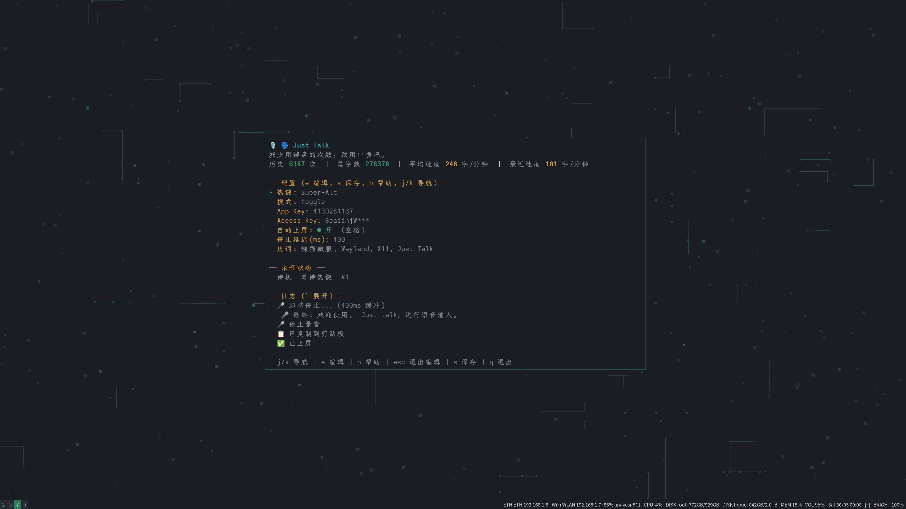

# Just Talk

[English](README.en.md) · [项目主页](https://whoamihappyhacking.github.io/just-talk-go/)

减少用键盘的次数，改用口喷吧。

Just Talk 是一个面向桌面环境的语音输入工具。它通过全局快捷键录音，把语音识别结果复制到剪贴板，或直接上屏到当前输入框，适合写代码、聊天、记笔记和处理长文本输入。

在 TUI 中修改 App Key 或 Access Key 后，退出编辑模式并按 `s` 保存；下一次录音会使用新凭证，无需重启。正在识别的录音继续使用建立连接时的凭证。

## 截图



## 功能

- 全局快捷键录音，支持 `toggle` 和 `hold` 两种模式。
- 语音热键限定为适合作为全局快捷键的按键：支持纯修饰键、功能键、Tab、CapsLock、方向键和导航键等；不支持字母、数字、标点、空格等普通字符键。
- 豆包大模型流式 ASR，支持双向流优化版和二遍识别。
- 自动复制到剪贴板，支持自动上屏。
- Wayland / X11 / macOS / Windows 顶层录音状态胶囊提示。
- TUI 配置界面，支持热键、模式、自动上屏、停止延迟、热词等配置。
- 热词增强识别，适合项目名、人名、英文术语和专有名词。
- 录音历史统计，包括历史次数、总字数、平均速度和最近速度。

## 平台状态

当前支持 Linux、macOS 和 Windows 桌面：

| 平台 | 状态 | 说明 |
| --- | --- | --- |
| Linux Wayland | 已支持 | 已支持 Sway / wlroots 场景；快捷键基于 evdev，需要 input 权限 |
| Linux X11 | 已支持 | 使用 X11 原生全局热键 |
| macOS | 已支持 | 全局快捷键基于 CGEventTap，录音使用 CoreAudio，剪贴板使用 NSPasteboard，胶囊显示使用 AppKit NSPanel |
| Windows 10/11 | 已支持 | 全局按键轮询及低级键盘钩子边沿回退、WinMM 录音、Unicode 剪贴板、SendInput 自动上屏和 Win32 状态胶囊 |

## 构建

Just Talk 依赖平台原生能力。Linux 和 macOS 构建需要启用 cgo；Windows 使用纯 Go 的 Win32 调用，不需要 cgo。

Linux 构建依赖：

```bash
# Arch Linux
sudo pacman -S --needed go gcc libx11 libxtst libxext wayland

# Debian / Ubuntu
sudo apt install golang-go build-essential libx11-dev libxtst-dev libxext-dev libxinerama-dev libwayland-dev
```

macOS 构建依赖：

```bash
# 需要 Apple Command Line Tools 提供 clang 和 macOS SDK；不需要安装完整 Xcode。
xcode-select --install
```

Windows 构建依赖：

```powershell
# 安装 Go 1.25 或更高版本；不需要额外安装 ffmpeg、SoX 或 C 编译器。
winget install --id GoLang.Go --exact
```

构建当前平台二进制：

```bash
cd just-talk-go
CGO_ENABLED=1 go build -o build/just-talk ./cmd/just-talk
```

Windows PowerShell：

```powershell
cd just-talk-go
go build -o build\just-talk.exe .\cmd\just-talk
```

安装到 `~/.local/bin/just-talk`：

```bash
# 确保 ~/.local/bin 在 PATH 中（如未配置，将下面这行加入 ~/.bashrc 或 ~/.zshrc）
# export PATH="$HOME/.local/bin:$PATH"
build/just-talk --install
# 或
make install
```

macOS 需要在本机 macOS 上构建；项目不提供非 cgo 版本。

Windows 安装到 `%LOCALAPPDATA%\Programs\Just Talk\just-talk.exe`：

```powershell
.\build\just-talk.exe --install
# 如果安装目录尚未在 PATH 中，按命令输出提示添加即可。
```

## Release 下载

GitHub Release 提供以下预编译归档：

- Linux amd64 / arm64
- macOS Intel / Apple Silicon
- Windows amd64 / arm64
- `SHA256SUMS.txt` 文件校验

发布流程使用 GoReleaser v2 和官方 `goreleaser/goreleaser-action`。Linux、macOS 和 Windows 二进制分别在对应的 GitHub 托管 runner 上原生构建；维护者推送 `v*` 标签时会自动构建并发布，例如：

```bash
git tag v0.7.0
git push origin v0.7.0
```

## 使用

默认启动 TUI：

```bash
just-talk
```

后台模式：

```bash
just-talk --no-tui
```

指定后端：

```bash
just-talk --backend wayland
just-talk --backend x11
```

Windows 不需要指定后端。首次使用前可检查麦克风和配置：

```powershell
.\build\just-talk.exe --doctor
```

默认关闭「省流量」，使用原有 WebSocket 模式：录音会在内存中持续缓存。录音读取与 WebSocket 发送独立运行，网络卡顿不会阻塞本地缓存。连接失败、音频发送失败或未收到最终识别结果时，自动按 1、2、4 秒间隔重连最多 3 次，每次从头重发同一段录音，无需按键或重录。发送超时为 15 秒，最终结果等待为 30 秒。ASR 单条响应上限为 8 MiB，避免较长录音的完整文本和分句信息超过 WebSocket 默认 32 KiB 限制而反复断连。自动恢复仍失败时等待按 `R` 开始新一轮恢复；认证或配置错误直接等待 `R`。只在收到完整最终结果后输出文字，避免把半段结果当作成功。断网时仍可继续录音，停止后缓存和等待状态会一直保留，直到成功、按 `Esc` 取消或退出程序。TUI 显示失败原因和“等待 R 重试”，悬浮窗显示 `R?`。剪贴板或上屏失败时也保留文字，按 `R` 重试输出。多段录音失败时，`R` 优先重试最近失败的录音；按 `Esc` 取消当前录音及所有等待中的重试。缓存仅在内存中，退出后不会保留。麦克风未能启动时没有可恢复的录音，需修复设备或权限后重新录制。

### 省流量开关：停止后一次性识别

在 TUI 中选中「省流量」，按 `e` 进入编辑、空格切换开/关、回车保存；也可在现有配置的 `[voice]` 下添加：

```toml
save_traffic = true # 默认 false，保留原来的 WebSocket 模式
```

- **开**：录音期间只缓存、不连接 ASR；停止并收齐尾音后，将完整 PCM 包装为 WAV，通过一次 HTTP POST 提交 Base64 音频并直接获取文字。接口为 `https://openspeech.bytedance.com/api/v3/auc/bigmodel/recognize/flash`，不是 WebSocket，也不需要文件外链或轮询。
- **关**：保留原有边录边发送的 WebSocket 模式和自动重连。开关保存后从**下一段录音**生效，不改变当前录音或待重试任务的方式。
- **权限**：复用现有 App Key / Access Key，但应用必须单独开通 `volc.bigasr.auc_turbo`；该模式固定使用此资源，不修改 WebSocket 的 `resource_id`。两种服务的权限与计费需分别在控制台确认。
- **重试**：单次 HTTP 请求最长等待 5 分钟。失败、静音判定或空文字都保留内存缓存，等待 `R` 再整段提交；不会自动重发或偷偷切回 WebSocket，以免失败响应不确定时反复产生费用。`Esc` 或退出仍会丢弃缓存；**目前没有磁盘备份或重启恢复**。
- **限制**：官方限制为 WAV 文件不超过 100 MB、音频不超过 2 小时；本机 PCM16/16 kHz/单声道 WAV 会先触及大小上限（约 52 分钟）。本地提交前检查大小。官方建议直接上传尽量在 20 MB 以内；较长录音会增加上传等待和内存占用。
- **名称说明**：「省流量」表示停止后整段识别，不承诺更低流量。Base64 会使音频数据约增大三分之一，停止后的等待通常也更长。两种模式都不额外调用聊天模型整理文字。

参见[官方录音文件极速版 HTTP 文档](https://www.volcengine.com/docs/6561/1631584)和[请求参数说明](https://www.volcengine.com/docs/6561/1354868)。

## 识别结果的自动处理

Just Talk 直接输出上游 ASR 的最终文字，没有额外调用聊天大模型进行总结、润色或结构化整理。WebSocket 模式发送到上游的参数固定在 `plugins/voice/asr.go`，尚未提供对应的 TOML/TUI 开关：

| 参数 | 当前值 | 含义 |
| --- | --- | --- |
| `enable_punc` | `true` | 请求自动添加标点 |
| `enable_itn` | `true` | 请求数字等逆文本规整，例如把口述数字转为数字形式 |
| `enable_ddc` | `false` | 不请求语义顺滑 |
| `enable_nonstream` | `true` | 请求二遍识别；是否生效取决于接口和模型支持，并非调用独立的文字整理服务 |

这些参数在 v0.0.3 已存在，弱网恢复修复没有改变它们。标点、数字格式或最终识别措辞的变化，不能单独证明上游新增或默认开启了“智能整理”。

默认 WebSocket 接口为 `wss://openspeech.bytedance.com/api/v3/sauc/bigmodel_async`，默认资源 ID 为 `volc.bigasr.sauc.duration`。官方文档另列出 2.0 资源 `volc.seedasr.sauc.duration`；本项目没有自动迁移到该资源。实际使用哪个资源取决于 `resource_id` 配置和账号开通情况。参见[官方 ASR 能力说明](https://www.volcengine.com/docs/6561/1354871?lang=zh)及[官方 ASR 资源版本说明](https://www.volcengine.com/docs/6348/1807452?lang=zh)（核对日期：2026-09-10）。

## 配置

默认配置路径：

```text
# Linux / macOS
~/.config/just-talk/config.toml

# Windows
%APPDATA%\just-talk\config.toml
```

推荐热键配置：

```toml
[voice]
mode = "toggle"
push_to_talk = "Alt+Super"
```

`Alt+Super` 配合 `toggle` 模式是推荐用法。按一次开始录音，再按一次停止录音，避免按住模式下和桌面环境或输入框发生按键冲突。在 Windows 上，低级键盘钩子只观察按键边沿，不会消费或回放修饰键，因此单独使用 `Alt`、`Super` 或 `Alt+Tab` 时会保持系统原有行为。组合键必须精确匹配配置的修饰键集合；钩子回退状态会通过未拦截的物理按键状态校验，避免把两次独立的单键按下拼成组合键。

语音热键只支持适合作为全局快捷键的按键：

- 支持：纯修饰键组合，如 `Alt+Super`、`Ctrl+Alt+Shift`。
- 支持：功能键 `F1` 到 `F24`，如 `F9`、`Alt+F8`。
- 支持：非文本控制键和导航键，如 `Tab`、`Enter`、`Escape`、`Backspace`、`CapsLock`、`Up`、`Down`、`Left`、`Right`、`Home`、`End`、`PageUp`、`PageDown`、`Insert`、`Delete`。
- 不支持：字母、数字、标点、空格、数字小键盘数字和符号等会输入文本的按键，如 `Alt+G`、`G`、`Alt+1`、`Alt+Space`。

热词示例：

```toml
[voice]
hotwords = ["Wayland", "Sway", "wl-copy", "wtype", "just-talk-go"]
```

macOS 热键写法：

```toml
[voice]
# Option 等价于 Alt，Command/Cmd 等价于 Super
push_to_talk = "Option+Command"
```

Windows 使用 `Win` 或 `Super` 表示 Windows 徽标键。如果麦克风不可用，请在“Windows 设置 → 隐私和安全性 → 麦克风”中允许桌面应用访问麦克风。

## 「省流量」到底是什么

`voice.save_traffic` 是一个**传输方式开关，不是流量优化开关**。名字容易误解，实际区别是：

| | 关（默认，WebSocket 流式） | 开（整段 HTTP） |
|---|---|---|
| 何时发送 | 边录边发 | 停止后一次性提交整段 |
| 编码 | 原始 PCM | WAV 经 Base64，**体积多约 33%** |
| 出结果 | 停止后很快 | 要等整段上传加识别 |
| 失败重传 | 断线重连要**从头重发整段** | 只发一次，不自动重试 |
| 依赖 | `volc.bigasr.sauc.duration` | 需另外开通 `volc.bigasr.auc_turbo` |

所以单次成功的情况下，开启它反而**更费流量**。它真正有用的场景是**弱网**：流式模式下每次断线重连都要把整段录音重新发一遍，网络差时同一段音频可能被发送三四次；整段模式只发一次，失败了也不会自动重发（因为重复提交可能重复计费），只能按 `R` 手动重试。

一句话：网络稳定就关着；网络差且录音较长，开启它可以避免反复重传，代价是出结果更慢、单次体积更大。

## 弱网表现

- 录音和网络完全解耦：断网时照常录音，音频在内存中缓存，不会因为网络卡顿而丢字。
- 连接失败、发送失败或拿不到最终结果时，按 1、2、4 秒退避自动重连最多 3 次，每次从头重发整段录音。
- 服务端明确拒绝请求的错误码（`45xxxxxx`，如参数无效、音频格式错误）会跳过退避阶梯直接等待 `R`；`55xxxxxx` 服务端故障和 `45000081` 等包超时仍然自动重试。
- 鉴权、配置类的 HTTP 4xx 同样直接等待 `R`，不浪费重连次数。
- 自动重连耗尽后保留录音，按 `R` 重试、按 `Esc` 放弃。

## 状态栏集成

除了内置的悬浮胶囊，Just Talk 也可以把录音状态写成 JSON，交给外部状态栏渲染：

```toml
[overlay]
enabled = false          # 关掉悬浮胶囊

[status_file]
enabled = true
path = ""                # 留空表示 $XDG_RUNTIME_DIR/just-talk/status.json
```

文件只在状态变化时原地重写，退出时删除，因此「文件不存在」表示没在运行，而不是空闲。

仓库里附带一个 Omarchy Quickshell 顶栏 widget，录音时显示录音点和已录时长，空闲时自动隐藏，配色跟随当前主题。安装方式和状态文件格式见 [integrations/omarchy/README.md](integrations/omarchy/README.md)。waybar、eww、polybar 也可以直接读同一个文件。

## 排查

录音后提示“录音几乎没有声音”，说明采集到的是静音，问题在麦克风而不是 ASR。先跑环境检查：

```bash
just-talk --doctor
```

「麦克风输入」一项会报出实测峰值。如果是纯静音（峰值 0），在 Linux 上通常是输入设备被静音：

```bash
wpctl set-mute @DEFAULT_AUDIO_SOURCE@ 0
wpctl set-volume @DEFAULT_AUDIO_SOURCE@ 0.85
```

同一段话被上屏两次，几乎都是同时跑了两个实例。Wayland 下热键用的是被动读取 `/dev/input/event*`，不独占设备，所以两个进程会收到同一次热键，各自识别、各自上屏。现在第二个实例启动时会直接报错退出；如果还在用旧版本，先确认只剩一个进程：

```bash
pgrep -a just-talk
```

## 更新日志

见 [CHANGELOG.md](CHANGELOG.md)。

## 维护与贡献

Just Talk 由 `whoamihappyhacking` 维护。

本项目不接受 Pull Request。欢迎通过 Issue 反馈 bug、使用体验和功能建议。

## 许可证

Just Talk 使用 GNU General Public License v3.0 开源。

## 项目介绍网页

在线访问：[Just Talk 项目介绍页](https://whoamihappyhacking.github.io/just-talk-go/)。推送 `website/` 更新到 `master` 后，GitHub Actions 会自动部署到 GitHub Pages。

静态介绍页位于 `website/`，包含功能、平台支持、快速开始与不调用麦克风的交互演示。启动预览：

```bash
python3 -m http.server 7788 --bind 0.0.0.0 --directory website
```
